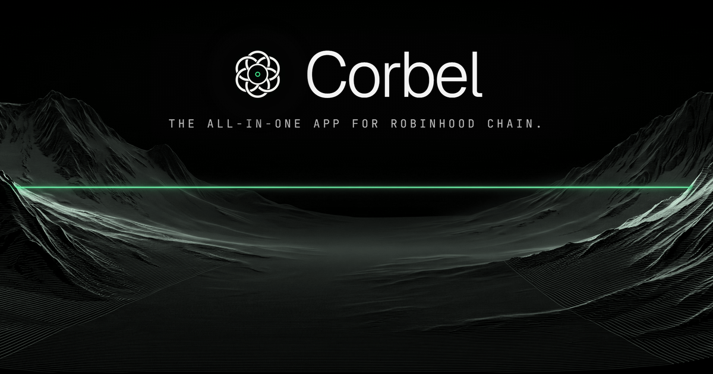

### The all-in-one app for Robinhood Chain

**Check** · **Swap** · **Earn** · **Agents** · **AI & GPUs**, from one wallet.

[corbel.finance](https://corbel.finance) · [Docs](https://corbel.finance/docs) · [X](https://x.com/corbelfinance) · [Telegram](https://t.me/corbelfinance)

---

| | |
|---|---|
| **Check** | Seven checks on any token before you buy, with the reasons behind the score. |
| **Swap** | Every route quoted at the latest block; you see amount out, gas and impact before you sign. |
| **Earn** | Pool fees and positions with the numbers each pool actually paid. |
| **Agents** | Bonded bots that trade only inside your rules. A broken rule costs the agent, not you. |
| **AI & GPUs** | Text, image, film and sound models in one chat, paid per use. |

**Code:** [CorbelFinance/Corbel](https://github.com/CorbelFinance/Corbel) · **Security:** contact@corbel.finance

Corbel never asks for a private key or a seed phrase.
